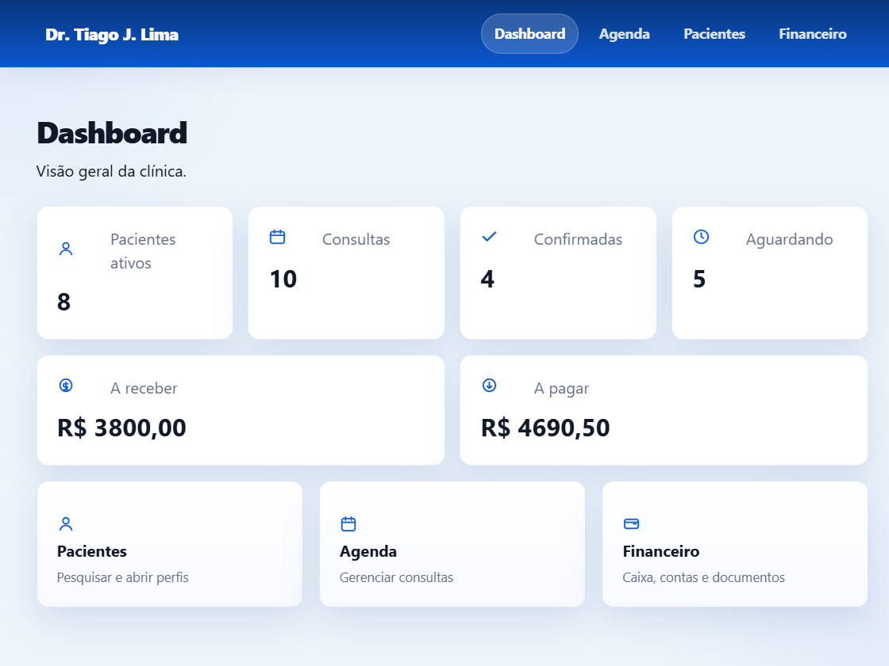
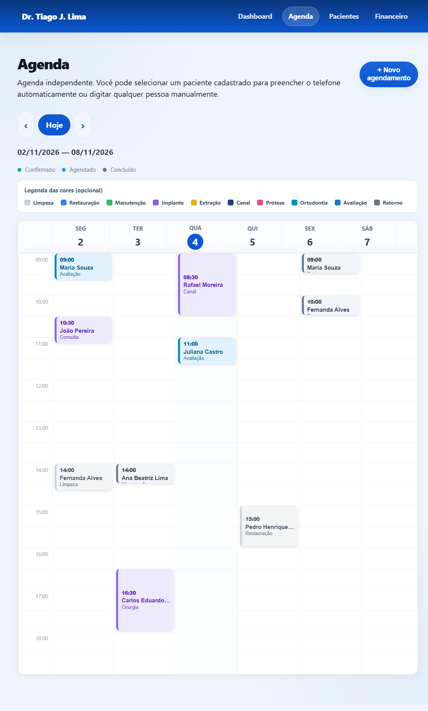
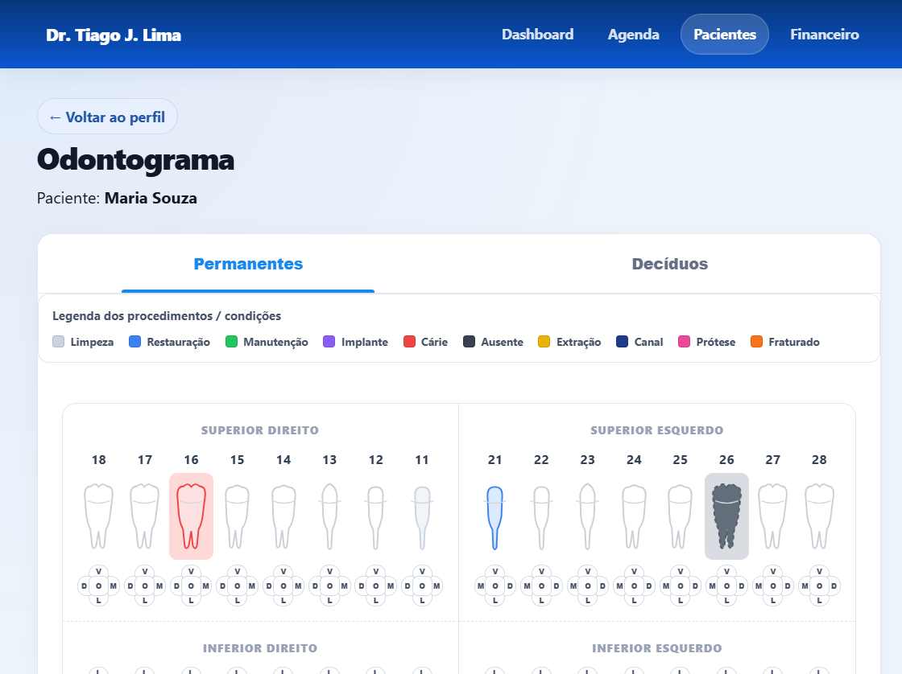
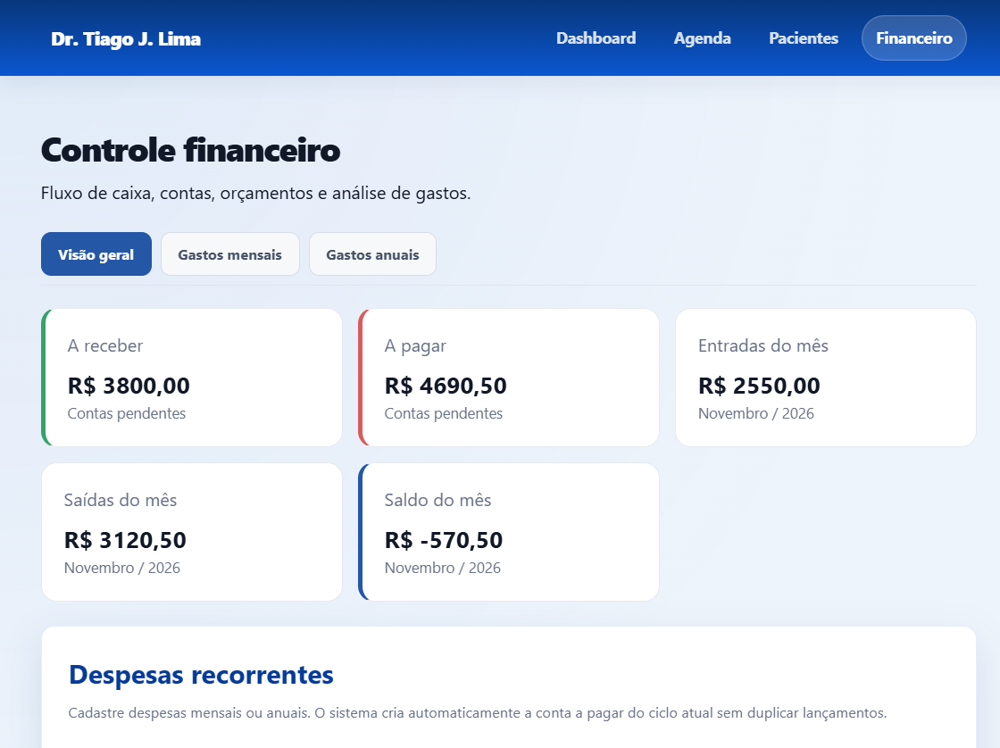

# Sistema Dentista

[](https://github.com/tiagoj-prog/sistema-dentista/actions/workflows/tests.yml)
[](LICENSE)

Sistema web para apoio à gestão de um consultório odontológico. O projeto utiliza Python, Flask, SQLite, HTML, CSS e JavaScript.

## Visão geral

O sistema concentra funcionalidades de:

- Cadastro e perfil de pacientes
- Agenda de consultas/eventos
- Odontograma e procedimentos por dente/face
- Controle de tratamentos
- Financeiro: orçamentos, contas a receber/pagar, movimentações, despesas recorrentes e relatórios
- Backup mensal do banco de dados

## Telas do sistema

Dashboard:



Agenda semanal:



Odontograma:



Financeiro:



As imagens usam dados fictícios. Nenhum dado real de paciente é publicado.

## Estrutura do projeto

```text
Sistema dentista/
├── app.py, main.py, run.py        # pontos de entrada (compatibilidade)
├── banco.py, pacientes.py, ...    # shims de compatibilidade (reexportam o pacote)
├── VERIFICAR_BANCO.py             # diagnóstico do banco
├── dentista.db                    # banco SQLite (não versionado)
├── backups/                       # backups mensais (não versionados)
├── docs/architecture.md
├── docs/screenshots/              # imagens usadas no README
├── scripts/                       # demonstração com dados fictícios
├── tests/test_smoke.py
└── sistema_dentista/
    ├── config.py                  # caminhos, host, porta, debug e chave secreta
    ├── web.py                     # factory do Flask e as 39 rotas
    ├── database/connection.py     # conexão SQLite e criação das tabelas
    ├── repositories/              # acesso a dados por domínio
    ├── services/                  # backup e resumo financeiro
    ├── templates/                 # páginas HTML
    └── static/                    # CSS, JS e ícones SVG
```

### Camadas

- `sistema_dentista/web.py`: rotas, validação de formulários e montagem de dados para os templates.
- `sistema_dentista/repositories/`: SQL e persistência, um módulo por domínio (pacientes, consultas, agenda, odontograma, tratamentos e financeiro).
- `sistema_dentista/services/`: regras que atravessam domínios (backup mensal e resumo financeiro).
- `sistema_dentista/database/`: conexão com SQLite (`sqlite3.Row`, foreign keys e WAL) e criação da estrutura.
- `sistema_dentista/config.py`: caminhos absolutos, `HOST`, `PORT`, `DEBUG` e chave secreta.

### Compatibilidade

Os arquivos `banco.py`, `pacientes.py`, `consultas.py`, `odontograma.py`, `tratamentos.py`, `agenda_visual.py`, `financeiro.py` e `backup.py` na raiz são **shims**: mantêm as mesmas funções públicas, mas apenas reexportam o pacote. Existem para não quebrar imports antigos e só podem ser removidos em uma etapa futura, com autorização e testes.

## Tecnologias

- Python
- Flask
- SQLite
- HTML
- CSS
- JavaScript

## Requisitos

- Python 3 instalado
- Dependências listadas em `requirements.txt`

Instalação:

```bash
python -m venv .venv
.venv\Scripts\activate
pip install -r requirements.txt
```

## Como executar

Formas equivalentes e compatíveis:

```bash
python run.py
```

Também funcionam:

```bash
python app.py
python main.py
```

A aplicação escuta em `127.0.0.1:5000` e inicia sem debug ativo por padrão.

## Configuração

Não é necessário criar arquivo `.env` para rodar localmente. As configurações ficam em `sistema_dentista/config.py` e podem ser sobrescritas por variáveis de ambiente:

| Variável | Efeito |
| --- | --- |
| `SECRET_KEY` | Chave de sessão do Flask. Se ausente, é gerada e persistida em `.secret_key`. |
| `FLASK_DEBUG` | `1`, `true` ou `yes` ativam o modo debug. Padrão: desligado. |

`HOST` (`127.0.0.1`) e `PORT` (`5000`) são definidos em `config.py`.

## Demonstração com dados fictícios

Para conhecer o sistema sem tocar no banco real:

```bash
python scripts/seed_demo.py
python scripts/run_demo.py
```

O primeiro comando cria `demo/dentista_demo.db` com pacientes, agenda, odontograma e lançamentos fictícios. O segundo inicia a aplicação em `http://127.0.0.1:5001` usando esse banco.

## Demonstração online

A demo também pode ser hospedada gratuitamente no Render para
compartilhar um link com dentistas. Veja `docs/deploy_render.md`.

A pasta `demo/` é ignorada pelo Git e o banco real nunca é usado.

## Testes

Execute os smoke tests:

```bash
python -m unittest tests.test_smoke
```

Os testes verificam a criação da aplicação, a quantidade de rotas (39), os endpoints esperados e o registro do backup mensal. Eles não inicializam o banco nem executam migrações.

O workflow `.github/workflows/tests.yml` executa esses testes automaticamente a cada push e pull request na branch `main`.

## Banco de dados

O banco principal está em:

```text
dentista.db
```

Também podem existir, em modo WAL:

```text
dentista.db-wal
dentista.db-shm
```

Esses arquivos devem ser considerados parte do estado operacional do SQLite e não devem ser excluídos manualmente enquanto a aplicação estiver em execução.

## Backups

Os backups mensais são armazenados em:

```text
backups/
```

Antes de qualquer operação importante, recomenda-se criar uma cópia segura externa do banco e da pasta `backups/`. Para cópia consistente, deve-se usar a API de backup do SQLite, e não apenas copiar o arquivo `.db`.

## Verificação de integridade

O script `VERIFICAR_BANCO.py` exibe o banco utilizado e as colunas da tabela `pacientes`.

Também é recomendado validar:

```sql
PRAGMA integrity_check;
```

## Restauração manual de backup

A restauração do banco deve ser feita com a aplicação parada.

Procedimento conservador:

1. Pare a aplicação.
2. Escolha um backup válido em `backups/dentista_YYYY-MM.db`.
3. Valide a cópia com `PRAGMA integrity_check`.
4. Registre as contagens atuais das tabelas principais do banco atual.
5. Copie o banco atual para um local seguro, por exemplo `dentista.db.pre-restauracao`.
6. Certifique-se de que a aplicação está parada antes de substituir `dentista.db`.
7. Se existirem `dentista.db-wal` ou `dentista.db-shm` antigos e não utilizáveis, mova-os para o local seguro antes da substituição.
8. Substitua `dentista.db` pela cópia validada do backup.
9. Inicie a aplicação novamente.
10. Valide:
   - `PRAGMA integrity_check`;
   - contagens das tabelas;
   - funcionamento das páginas principais.

Não substitua o banco sem validar a integridade do backup. Não sobreponha registros reais sem cópia de segurança.

## Segurança dos dados

- Não apague, recrie ou limpe o banco de dados sem autorização.
- Não exclua pacientes, consultas, pagamentos ou outros registros sem autorização.
- Não execute migrações automaticamente nem altere tabelas sem planejamento e backup.
- Preserve a compatibilidade com os dados e tabelas existentes.

## Organização do código

A arquitetura em camadas descrita acima já está implementada. O documento `docs/architecture.md` registra a estrutura atual, o modelo de dados, as decisões de projeto e as pendências conhecidas. Qualquer reorganização adicional deve ser feita com autorização, backup e testes.

## Arquivos temporários e ignorados

Arquivos gerados pelo Python, ambientes virtuais e dados mutáveis de runtime são ignorados conforme `.gitignore`. Configurações compartilháveis da pasta `.vscode/` podem ser versionadas quando apropriado.

## Licença e uso

Este projeto usa a **PolyForm Noncommercial License 1.0.0**. O texto completo está em `LICENSE`.

Resumo em linguagem simples:

| Uso | Permitido? |
| --- | --- |
| Ler, estudar e executar o sistema | Sim |
| Usar em projeto pessoal, pesquisa ou teste | Sim |
| Usar em escola, ONG, órgão público ou instituição de saúde pública | Sim |
| Copiar e modificar para uso pessoal | Sim |
| Usar em clínica ou empresa com finalidade comercial | **Não** |
| Vender o software ou um produto baseado nele | **Não** |
| Oferecer o sistema como serviço pago | **Não** |

Quem recebe uma cópia deve manter o aviso de copyright e o link da licença.

Para uso comercial, é necessário autorização por escrito do autor. O contato pode ser feito pelo perfil no GitHub: [@tiagoj-prog](https://github.com/tiagoj-prog).

> Este resumo é apenas orientação. O texto do `LICENSE` é o que vale juridicamente.